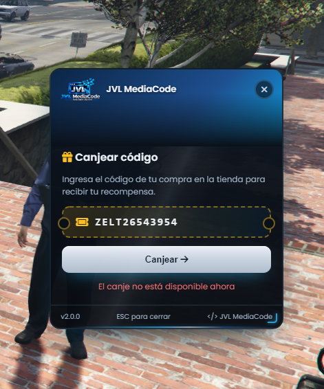
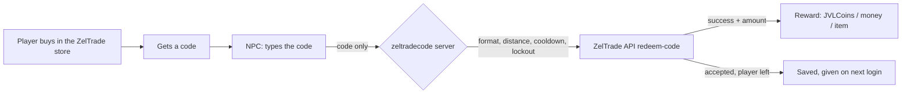

<div align="center">



<br>


**Your ZelTrade store, inside the city.**
Players buy in your ZelTrade store, get a code and redeem it with an NPC. The server checks the code with ZelTrade and gives the reward: JVLCoins, money or an item.

[Features](#-features) · [Preview](#-preview) · [How it works](#-how-it-works) · [Installation](#-installation) · [License](#-license)

</div>

---

## ✨ Features

<table>
<tr>
<td width="50%" valign="top">

### 🎁 Redeem at an NPC
An NPC with a blip opens the redeem panel through ox_target, qb-target or the **[E]** key (auto-detected). Type the code, press Enter, done.

### 💰 Any reward
The amount the API returns is given as **JVLCoins** (jvl_playtime), any **money account** of your framework (`bank`, `cash`, `black_money`, `coin`…) or an **inventory item** (ox_inventory or the framework one).

### 🌐 Multiframework
Qbox, QBCore and ESX, auto-detected. Spanish and English, picked from the player's GTA language.

</td>
<td width="50%" valign="top">

### 🔐 Key never leaves the server
The ZelTrade API key is a server convar. Players only send the code; the server talks to ZelTrade.

### 🛡️ Anti brute force
Code format check, distance to the NPC, a cooldown between tries and a lockout after too many wrong codes, all on the server.

### 📦 Nothing gets lost
If ZelTrade accepts a code but the player left before getting the reward, it is saved for that character and given on the next login. Optional Discord log of every redeem.

</td>
</tr>
</table>

## 🖼️ Preview

<div align="center">
<br>
<sub>Redeem panel: server banner, gold gift ticket code field, result line</sub>
</div>

## 🔄 How it works



The server is the only side that knows the API key and the reward type. The code is checked again on the server (4–30 letters, numbers or dashes), the player must be next to the NPC, and only one request per player can be waiting for ZelTrade at a time.

<details>
<summary>📁 Project structure</summary>

```text
zeltradecode/
├── config.lua          framework, API url, branding, reward, NPC, blip, target, limits, Notify / TextUI
├── shared.lua          framework detection, locale helper, code validation (with self-check)
├── server.lua          ZelTrade API calls, checks, reward bridge, pending rewards (KVP), Discord log
├── client.lua          NPC + blip, ox_target / qb-target / [E], redeem panel
├── locales/            es.lua, en.lua
├── web/                index.html, jvl-steel-blue.css, style.css, script.js
└── assets/readme/      banner + screenshot
```

</details>

<details>
<summary>🔐 Configuration</summary>

Secrets go in a **server-only** cfg (`set`, never `setr` / `sets`):

```cfg
set zeltrade_api_key "your-key-from-the-zeltrade-dashboard"
set zeltradecode_webhook ""   # optional Discord webhook for the redeem log
```

`config.lua` is sent to the players, so it holds no secret. Main options:

| Option | What it does |
|---|---|
| `Config.Reward` | `type = 'coins'` (JVLCoins) · `'account'` (`name` = money account) · `'item'` (`name` = item) |
| `Config.Ped` | NPC model, coords (`vector4`) and scenario |
| `Config.Blip` | blip on / off, sprite, color, scale |
| `Config.Target` | `'auto'` · `'ox_target'` · `'qb-target'` · `'key'` |
| `Config.MaxDistance` | max meters from the NPC to redeem (server) |
| `Config.Cooldown` / `Config.MaxFails` | seconds between tries / wrong codes before a lockout and its minutes |
| `Config.Branding` | server name, logo and banner of the panel |

</details>

## 🚀 Installation

1. Put `zeltradecode` in your resources and `ensure` it after your framework. It declares **no fxmanifest dependencies**, no tables.
2. Add `set zeltrade_api_key "..."` to a server-only cfg (the API key from your ZelTrade dashboard) and restart the server.
3. Set the NPC coords and the reward in `config.lua`. With `Config.Reward.type = 'coins'` start `jvl_playtime` too.
4. The console shows `[zeltradecode] Licencia válida` when the key works.

Required: one of `qbx_core`, `qb-core` or `es_extended`. Optional: `ox_target` / `qb-target`, `jvl_playtime` (JVLCoins), `ox_inventory`, `jvl_notify`, `jvl_textui`, `ox_lib`.

<details>
<summary>🛠️ Operation notes</summary>

- Pending rewards are stored per character in the resource KVP (`pendiente:<citizenid / identifier>`) and given 5 s after login.
- Every redeem is printed in the server console; with the webhook set it also goes to Discord (green = given, orange = pending).
- A wrong code, a used code or an API error counts towards the lockout; a successful redeem resets it.

</details>

## 📋 Pending

- Test QBCore and ESX on a real server (built and tested on Qbox).

## 📄 License

Free. Released under the **MIT License** — free to use, modify and share, keeping the copyright notice. See [`LICENSE`](LICENSE).

© 2026 JVL MediaCode

<div align="center">

Made by **JVL MediaCode** · Jose M. Valenzuela · Meoqui, Chihuahua, México
[contacto@jvlmediacode.com](mailto:contacto@jvlmediacode.com) · [Discord](https://discord.gg/RP2SrCFTHx)

</div>
